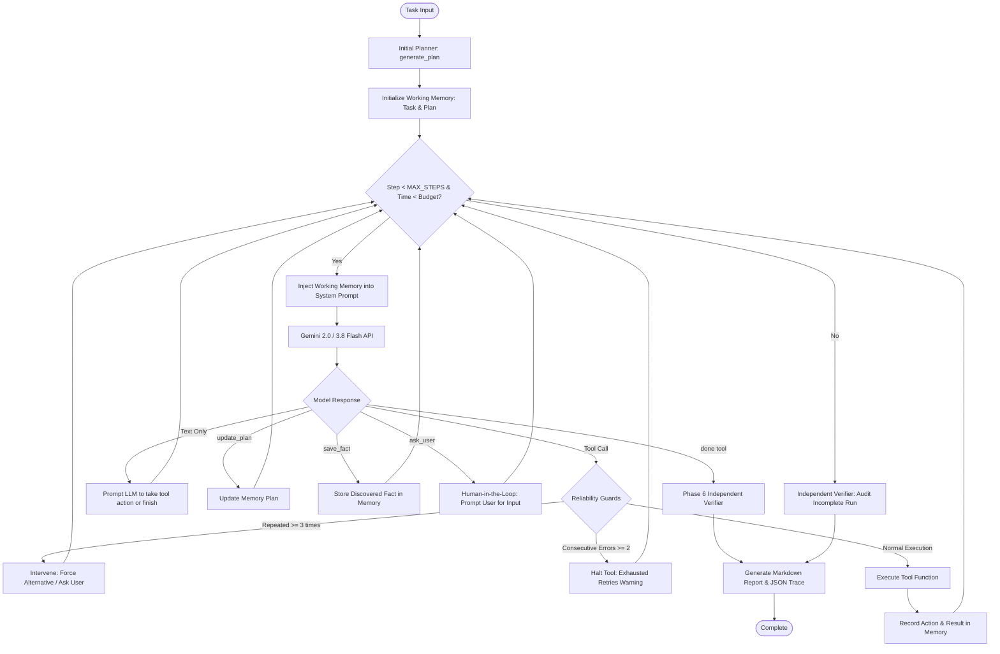

# Autonomous AI Task Worker

An autonomous, framework-free AI worker capable of completing natural language tasks across local files, websites, and internal company apps using the Gemini API, Playwright browser automation, working memory, reliability guards, and independent task verification.

Built from scratch using Python with **no LangChain, LangGraph, or CrewAI**.

---

## Agent Loop Architecture

The worker implements a custom ReAct-style agent loop where tools return observations back to the LLM. Thought signatures are preserved across function-calling round-trips to satisfy Gemini requirements.



---

## Models, APIs & Tools Used

- **LLM Engine**: Google Gemini API via official SDK (`google-genai`), model `gemini-3.8-flash` (configurable in `agent/config.py`).
- **Browser Automation**: Playwright headless Chromium for real web and app interaction (`tools/browser_tools.py`).
- **Internal Target App**: Flask + SQLite (`app/app.py`, `app/init_db.py`).
- **Interactive UI**: Streamlit (`streamlit_app.py`).
- **Document & PDF Parsing**: `pdfplumber` (for invoice parsing).
- **Tooling Platform**: Built with Antigravity.

---

## Project Structure

```text
ai_centelalign/
├── agent/
│   ├── agent.py          # Core task-agnostic agent loop & loop guards
│   ├── config.py         # Tuneable settings (model, step limits, timeouts)
│   ├── llm.py            # Gemini API wrapper with function calling & planner
│   ├── memory.py         # Working memory (facts, dynamic plan, action history)
│   └── verifier.py       # Independent verifier & markdown report generator
├── app/
│   ├── app.py            # Mock company invoice management Flask app
│   ├── init_db.py        # Database schema initializer & sample seeder
│   └── templates/        # HTML templates with stable CSS IDs (#login-btn, etc.)
│       ├── layout.html
│       ├── login.html
│       ├── list.html
│       └── add_invoice.html
├── tools/
│   ├── registry.py       # ToolRegistry mapping schemas to Python callables
│   ├── file_tools.py     # File system tools: list_files, read_file
│   └── browser_tools.py  # Playwright tools: open_url, click, type_text, read_page
├── tests/
│   ├── test_app.py             # Flask app unit & route tests
│   ├── test_browser.py         # Browser integration test script
│   ├── test_memory_planning.py # Working memory & plan formatting tests
│   ├── test_reliability.py     # Loop detector, retry limits, domain allowlist tests
│   └── test_verifier.py        # Verifier & final report generator tests
├── sample_data/
│   └── sample_note.txt   # Test file for file reading tools
├── runs/                 # Output directory for run_*.json traces & report_*.md files
├── main.py               # CLI runner for the agent
├── streamlit_app.py      # Interactive Streamlit agent dashboard
├── requirements.txt      # Python dependencies
├── .env.example          # Environment variable template
└── README.md             # Project documentation
```

---

## Setup Instructions

### Prerequisites
- Python 3.11 or higher
- Google Gemini API Key from [Google AI Studio](https://aistudio.google.com/)

### 1. Clone & Create Virtual Environment
```bash
# Create virtual environment
python -m venv .venv

# Activate virtual environment
# On Windows (PowerShell):
.venv\Scripts\Activate.ps1
# On macOS / Linux:
source .venv/bin/activate
```

### 2. Install Dependencies & Playwright Browsers
```bash
pip install -r requirements.txt
playwright install
```

### 3. Configure Environment Variables
Copy `.env.example` to `.env` and insert your Gemini API key:
```bash
copy .env.example .env
```
Inside `.env`:
```ini
GEMINI_API_KEY=your_actual_gemini_api_key_here
```

### 4. Initialize the Mock App Database
Initialize the SQLite database with seed invoices:
```bash
python app/init_db.py
```

---

## How to Run

### 1. Mock Company App (Flask)
Start the mock invoice management portal in its own terminal:
```bash
python -m app.app
```
- **URL**: `http://127.0.0.1:5000/`
- **Authentication**: Accepts any username/password (e.g. Username: `admin`, Password: `secret`).

### 2. Streamlit Web Dashboard
Launch the interactive web UI in a separate terminal:
```bash
python -m streamlit run streamlit_app.py
```
- Opens at `http://localhost:8501`.
- Lets you select task presets, submit custom instructions, watch live execution steps, inspect working memory, and view the final report.

### 3. Command Line Interface (CLI)
You can also run the agent directly from the command line:
```bash
python main.py "List all files in sample_data/ and tell me what is inside them."
```

---

## Example Tasks to Try

1. **File Inspection**:
   ```text
   "List all files in sample_data/ and summarize what is in each file."
   ```
2. **Web Portal Login & Invoice Extraction**:
   ```text
   "Open http://127.0.0.1:5000/login, log in with username 'admin' and password 'secret', read the invoices on the page, and report the total amount for Acme Corp."
   ```
3. **Adding Records via UI**:
   ```text
   "Log into http://127.0.0.1:5000/login, click 'Add Invoice', and create a new invoice for 'Beta Supplies' for $320.00 due on '2026-12-01'."
   ```
4. **External Web Browsing**:
   ```text
   "Navigate to https://example.com, read the page, and summarize its contents."
   ```

---

## Architecture & Key Design Decisions

1. **Custom Agent Loop (No Frameworks)**:
   - Built directly using Python and `google-genai`. All prompt assembly, tool dispatching, and state management are explicit, readable, and fully debuggable.
2. **Task-Agnostic Core (`agent/agent.py`)**:
   - The loop contains zero domain-specific logic. It only knows how to invoke tools, enforce safety limits, and pass observations.
3. **Tool Errors Returned as Observations**:
   - When a tool fails (e.g., element not found, network error), the error is caught and returned as a string observation to the LLM. The agent never crashes on tool failure; it is given the chance to adapt and recover.
4. **Reliability Guards**:
   - **Loop Detection**: Intercepts repeated identical actions if called 3 times consecutively (`LOOP_DETECTION_THRESHOLD = 3`), forcing the model to try another strategy or ask the human.
   - **Bounded Retries**: If a tool repeatedly returns errors (`MAX_RETRIES_PER_ACTION = 2`), subsequent calls are blocked with a retry-exhausted observation.
   - **Human-in-the-Loop (`ask_user`)**: The agent can ask clarification or confirmation when missing critical information or before irreversible actions.
5. **Open Domain Browsing**:
   - Configurable domain allowlist in `agent/config.py` (`ALLOWED_DOMAINS = ["*"]`), allowing navigation to non-localhost URLs while retaining the option to restrict access to internal domains.
6. **Every Run Persisted**:
   - Every execution writes a JSON trace to `runs/run_<timestamp>.json` and a Markdown audit report to `runs/report_<timestamp>.md`.

---

## Reliability and Verification Explained

Per the rule: *"Never declare a task done without independent verification"*:
- When the agent finishes and calls the `done` tool, an **Independent Verifier** (`agent/verifier.py`) audits the run before declaring completion.
- The verifier compares the original task instructions against:
  1. The agent's final claim/summary.
  2. The action history (what tools were called and what data they actually returned).
  3. Discovered facts recorded in working memory.
- It produces a formal verdict (`VERIFIED` or `DISCREPANCIES_FOUND`) and outputs a structured Markdown report highlighting concrete proof of completion and any missing criteria.

---

## Known Limitations, Assumptions & Future Work

### Assumptions
- Tools are synchronous.
- The Flask mock app runs locally at port 5000 during test execution.
- LLM connectivity is available via `GEMINI_API_KEY`.

### Known Limitations
- Single browser tab context: The Playwright browser tool currently operates within a single persistent browser page.
- Context window pruning: Very long-running tasks (>15 steps) rely on memory summarization and recent action history rather than full unbounded context.

### What to Build Next
1. **Full Benchmark Suite (Phase 7)**: An automated benchmark runner testing multi-step workflows end-to-end (PDF parsing, web submission, database verification).
2. **Visual Multimodal Browser Grounding**: Sending screenshots to Gemini for visual element grounding alongside text-based HTML inspection.
3. **Database Tooling**: Direct database inspection tool for backend verification in addition to browser inspection.
